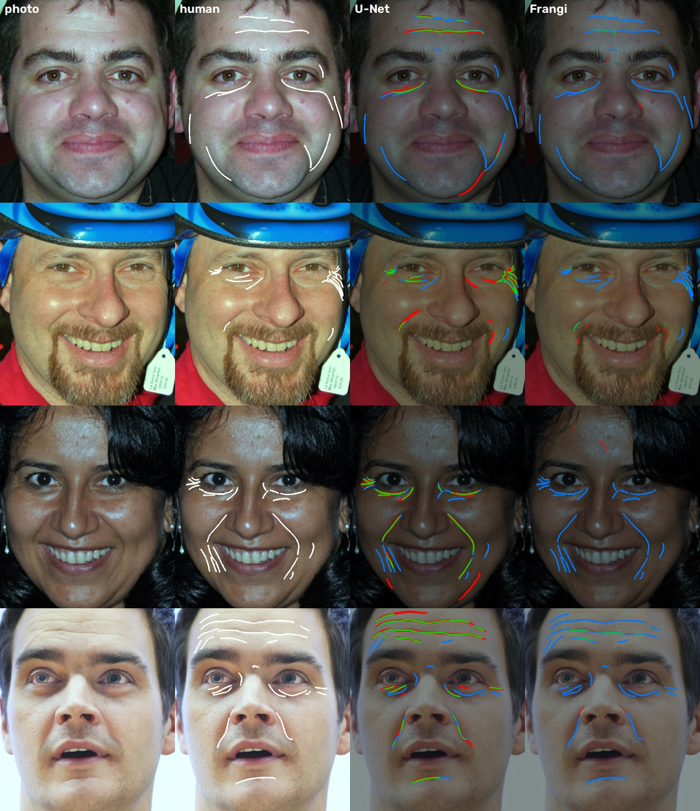

# Skinlens鏡面

**Skinlens鏡面**是一個臉部膚況分析網站。上傳一張臉部照片 → 自動前處理 → 分析斑點、皺紋、紋理、毛孔、棕色斑、紅色區 (加 UV 照片可再測紫外線色斑、紫質) → 報告告訴你**問題在哪裡、代表什麼、怎麼改善**。會員可以保存每次結果，用趨勢圖追蹤保養前後的變化。

參考醫美診所 VISIA 膚質檢測的做法，改用一般手機照片 + 影像處理 + 機器學習校正。

| 層 | 技術 |
|---|---|
| 前端 | HTML、CSS、JavaScript、jQuery 3.7、Bootstrap 5.3、Chart.js |
| 後端 | Python 3.12、Flask 3 (Blueprint、session 登入) |
| 資料庫 | MongoDB (pymongo)，本機或 MongoDB Atlas |
| 影像分析 | OpenCV、MediaPipe Face Landmarker (478 點)、scikit-image |
| 機器學習 | scikit-learn Gradient Boosting (校正模型) |

系統架構圖與流程圖：[docs/architecture.drawio](docs/architecture.drawio) (用 draw.io 打開)。

## 快速開始

需要：[uv](https://docs.astral.sh/uv/)、MongoDB Community Server (本機 `mongodb://localhost:27017`)。

```bash
uv sync                                   # 建立 .venv 並安裝套件 (Python 3.12)
cp .env.example .env                      # 修改 SECRET_KEY、管理員帳密
uv run python scripts/download_models.py  # 下載 MediaPipe 臉部模型 (3.7MB) 與網頁版偵測程式 (約 15MB，拍照引導用)
uv run python app.py                      # → http://localhost:5000
```

`.env` 的 `ADMIN_EMAIL` / `ADMIN_PASSWORD` 會在啟動時自動建立管理員帳號，登入後右上角會出現「後台」。

## 頁面

| 網址 | 說明 | 權限 |
|---|---|---|
| `/` | 上傳照片、分析報告 (問題位置標示、各指標說明與建議) | 所有人 |
| `/history` | 我的紀錄：分數趨勢圖、任選兩筆前後比較、刪除 | 會員 |
| `/knowledge` | 指標百科：每個指標代表什麼、依嚴重度的建議 | 所有人 |
| `/about` | 專案介紹與系統架構 | 所有人 |
| `/account` | 個人資料 (年齡/性別/膚質)、刪除全部資料 | 會員 |
| `/admin` | 統計、照片標註 (0~4 級)、模型訓練、匯出 CSV | 管理員 |

## 專案結構

```
app.py                         Flask 入口
skinlens/
  __init__.py                  create_app()：註冊 Blueprint、錯誤處理
  config.py                    設定 (讀 .env)
  db.py                        MongoDB 連線、集合、索引 (繁體中文排序 zh_Hant)
  auth.py                      註冊 / 登入 / 登出 / 權限檢查
  routes/
    pages.py                   頁面路由 (Jinja2 樣板)
    api.py                     分析、歷史紀錄、知識庫 API
    admin.py                   後台 API (統計、標註、訓練、匯出)
  services/
    analyzer.py                分析流程：前處理 → 指標 → 模型校正 → 同齡百分位 → 報告
    trainer.py                 Gradient Boosting 訓練 / 預測
  analysis/
    preprocess.py              EXIF 轉正、臉部偵測與對齊、白平衡、CLAHE、膚色遮罩、10 分區、品質檢查
    indicators.py              8 項指標演算法
    chromophore.py             黑色素 / 血紅素分離 (Tsumura 1999)、反光遮罩
    wrinkle_seg.py             AI 皺紋分割推論 (ONNX Runtime，CPU)
    knowledge.py               指標意義、原因、依嚴重度的建議、就醫提醒
  templates/  static/          前端 (Bootstrap + jQuery)
scripts/
  download_models.py           下載 MediaPipe 模型與網頁版偵測程式
  import_ffhq_wrinkle.py       匯入 FFHQ-Wrinkle 人工皺紋標註
  import_kaggle_skin.py        匯入 Kaggle 人工評分 (毛孔、紅色區、斑點、紋理)
  import_folder.py             批次匯入照片 + labels.csv
  calibrate.py                 用參考族群校準嚴重度曲線 → models/calib.json
  fit_chromophore.py           估計黑色素 / 血紅素方向 → models/chromophore.json
  reextract_features.py        演算法改動後重新計算全部特徵
  compare_features.py          新特徵的對照實驗 (重複 10 次分組)
  prepare_wrinkle_seg.py       皺紋分割資料準備 (轉到臉部座標、切分)
  train_wrinkle_seg.py         U-Net 皺紋分割訓練與評分 (GPU)
  export_wrinkle_onnx.py       U-Net 轉成 ONNX 給網站用 → models/wrinkle_seg.onnx
  eval_wrinkle_score.py        皺紋分數準確度比較 (AI 分割 vs. 分數模型 vs. 基準線)
  migrate_sqlite.py            舊版 SQLite 資料轉移到 MongoDB
  train_cnn.py                 第二階段 CNN (資料多時再用)
tests/test_app.py              端對端測試 (uv run pytest)
docs/                          架構圖 (draw.io) 與產生腳本
```

## MongoDB 集合

| 集合 | 用途 | 重要欄位 |
|---|---|---|
| `users` | 會員 | email (唯一)、name、password_hash、role (user/admin)、profile |
| `analyses` | 每次分析結果 (會員歷史、同齡百分位) | user_id、age、lighting、overall_score、results、report |
| `images` | 訓練用照片 | sha256 (唯一)、processed_path、features、split、source |
| `annotations` | 人工標註 = 訓練答案 | image_id、indicator、annotator、severity (0~4)、score (0~100) |
| `subjects` | 匿名受測者 | code、age、gender、skin_type |
| `model_versions` | 訓練紀錄 | name、deployed、metrics、n_samples |

## 分析流程

```
照片 → 前處理 (analysis/preprocess.py)
        1. EXIF 轉正、縮圖
        2. MediaPipe 偵測 478 個臉部特徵點 (必要；OpenCV 4 環境下才有 Haar 備援，OpenCV 5 已移除)
        3. 依雙眼連線轉正、裁切、縮放到寬 600px  ← 所有量測在同一尺度才能比較
        4. Shades-of-Gray 白平衡 (降低燈光色偏)、CLAHE 對比增強
        5. 自適應膚色模型 → 皮膚遮罩，排除頭髮眼眉嘴
        6. 切 10 個分區：額頭、眉間、左右眼尾、眼下、鼻、左右臉頰、法令紋、下巴
        7. 品質檢查：模糊、太暗、過曝、臉太小 → 顯示警告
     → 指標辨識 (analysis/indicators.py)：原始量測值 → 校準曲線 → 0~100 嚴重度、病灶遮罩、各分區數值
     → 黑色素 / 血紅素分離與反光遮罩 (analysis/chromophore.py)：額外的色素特徵
     → 模型校正 (services/trainer.py)：已上線的指標改用模型分數
     → 同齡百分位 (同年齡 ±5 歲、至少 10 筆)
     → 報告 + 建議 (analysis/knowledge.py)
```

## 準確度：怎麼校正的

1. **參考族群校準** (`scripts/calibrate.py`)：原本演算法的參數是經驗值，跟真實臉部差很多 (例如毛孔中位數 30，經驗值假設 12，幾乎人人被判「嚴重」)。改用 1,000 張 FFHQ 臉部當參考族群，在對數尺度上把第 65 百分位對到嚴重度 50、第 95 百分位對到 85。
2. **人工標註訓練** (`/admin` → 模型訓練)：用量測特徵預測人工分數的 Gradient Boosting 模型，5 折交叉驗證；只有誤差比「猜平均值」低 10% 以上的指標才上線。

目前結果 (0~100 分制)。皺紋改用 AI 分割直接計分，在 U-Net 沒看過的測試組 100 張上評分；其他指標是依原始照片分組的 5 折交叉驗證，重複 10 次取平均：

| 指標 | 標註來源 | 樣本 | 模型誤差 (MAE) | 基準線 | 改善 (平均) | 10 次範圍 | 相關係數 r | 狀態 |
|---|---|---|---|---|---|---|---|---|
| 皺紋 | FFHQ-Wrinkle 人工遮罩 | 測試 100 | 10.46 | 21.32 | 50.9% | — | 0.867 | ✅ AI 分割 (U-Net) 直接計分 |
| 紅色區 | Kaggle 人工評分 | 195 | 17.37 | 22.14 | 21.5% | 19.3 ~ 25.1% | 0.590 | ✅ 上線 |
| 斑點 | Kaggle 人工評分 | 195 | 19.83 | 22.80 | 13.0% | 9.7 ~ 15.0% | 0.457 | ✅ 上線 |
| 紋理 | Kaggle 人工評分 | 195 | 16.07 | 18.38 | 12.6% | 9.9 ~ 15.0% | 0.458 | ✅ 上線 |
| 毛孔 | Kaggle 人工評分 | 195 | 16.33 | 17.91 | 8.8% | 2.9 ~ 15.2% | 0.407 | 未達門檻，用校準分數 |
| 棕色斑 | Kaggle 人工評分 | 195 | 18.45 | 18.82 | 1.9% | -0.4 ~ 6.3% | 0.350 | 未達門檻，用校準分數 |
| 紫外線色斑、紫質 | — | 0 | — | — | — | — | — | 實驗性 (需 365nm UV 燈) |

皺紋答案 = 遮罩白線像素 ÷ 臉部面積，再用和其他指標相同的族群規則 (log 尺度、P65→50、P95→85) 換成分數 (`import_ffhq_wrinkle.py --relabel`)。

資料品質處理：Kaggle 的 200 筆評分裡有 3 張照片重複且評分不一致 (取平均)、10 張臉以 Roboflow 副本出現兩次 (同一組，避免交叉驗證洩漏)。

### 黑色素 / 血紅素分離 (對照實驗)

依 Tsumura et al. (JOSA A, 1999)：把照片轉成線性亮度的光學密度，用 FastICA 從 300 張 FFHQ 臉 (90 萬個皮膚像素) 估計黑色素、血紅素在相機 RGB 上的方向 (`scripts/fit_chromophore.py`)，每張照片分離出黑色素圖、血紅素圖；另外標出油光反射像素 (VISIA 用偏光濾鏡消除，一般相機沒有)。

同樣 10 種分組，加入這 31 個新特徵前後的誤差改善 (`scripts/compare_features.py`)：

| 指標 | 加入前 | 加入後 | 差異 | 10 次中變好 |
|---|---|---|---|---|
| 紅色區 | 13.2% | 21.3% | +8.1 | 10/10 |
| 紋理 | 7.6% | 10.2% | +2.6 | 10/10 |
| 棕色斑 | -0.4% | 1.9% | +2.2 | 8/10 |
| 斑點 | 12.0% | 12.9% | +0.8 | 7/10 |
| 皺紋 | 23.0% | 22.5% | -0.5 | 2/10 |
| 毛孔 | 9.9% | 8.0% | -1.9 | 0/10 |

顏色類指標都有幫助，看形狀的皺紋、毛孔反而變差，所以這兩項不使用色素特徵 (`trainer.FEATURE_EXCLUDE`)。
限制：陰影處的環境光偏藍，和黑色素方向重疊，黑色素圖仍會殘留部分陰影；血紅素圖則相當乾淨。

### 皺紋分割 (U-Net，RTX 5090)

讓模型直接看照片「畫出皺紋線」，再和 FFHQ-Wrinkle 的人工遮罩 (皺紋線 = 255) 逐像素對答案。

- 資料：1,000 張照片與遮罩都轉到前處理後的臉部座標 (`scripts/prepare_wrinkle_seg.py`)，固定切成 train 800 / val 100 / test 100
- 模型：U-Net + ResNet34 編碼器 (ImageNet 預訓練)，Dice + BCE 損失，bf16 混合精度，60 回合約 11 分鐘 (`scripts/train_wrinkle_seg.py`)
- 只用 val 挑最佳回合與門檻值，test 只在最後評分一次

| 測試組 100 張 | Dice | IoU | 容許 2px Dice | 召回率 (容許 2px) | 皺紋量相關 r |
|---|---|---|---|---|---|
| **U-Net (AI)** | **0.618** | **0.448** | **0.777** | **0.780** | **0.871** |
| Frangi 濾波 (原本的傳統演算法) | 0.108 | 0.057 | 0.215 | 0.136 | 0.441 |



#### 皺紋分數：AI 分割直接計分 vs. 分數模型

U-Net 畫出的線條像素 ÷ 臉部面積，套用和人工答案完全相同的換算，就是皺紋分數，不需要再訓練分數模型。同樣在測試組 100 張上比較 (`scripts/eval_wrinkle_score.py`，分數模型只用其他 900 張訓練)：

| 測試組 100 張 | 平均誤差 MAE | 比基準線改善 | 相關係數 r | 等級完全猜中 | 差一級以內 |
|---|---|---|---|---|---|
| **AI 分割直接計分** | **10.46** | **50.9%** | **0.867** | **56%** | **95%** |
| 分數模型 (Gradient Boosting) | 15.71 | 26.3% | 0.589 | 42% | 83% |
| 基準線 (一律猜平均) | 21.32 | — | — | 24% | 64% |

等級是 優良 / 輕微 / 中等 / 明顯 / 嚴重 五級 (每 20 分一級)。網站上推論用 ONNX Runtime 在 CPU 跑 (約 0.1 秒 / 張，`scripts/export_wrinkle_onnx.py` 轉檔)。
限制：測試照片是高畫質正臉；模糊、臉太小或做表情的自拍，細紋容易漏掉，分數會偏低。

範例照片來自 FFHQ (各照片依原作者的 Creative Commons 授權)，遮罩來自 FFHQ-Wrinkle (CC BY-NC-SA 4.0)。

訓練環境：`uv sync --extra train` 會安裝 CUDA 12.8 版 PyTorch (RTX 5090 / Blackwell 需要 12.8 以上)；網站本身不需要 PyTorch，`requirements.txt` 也不含。

### 重建資料 (新電腦)

```bash
# FFHQ-Wrinkle 遮罩：https://github.com/labhai/ffhq-wrinkle-dataset ；對應照片：FFHQ images1024x1024
uv run python scripts/import_ffhq_wrinkle.py <images 資料夾> <manual_wrinkle_masks 資料夾>
# Kaggle：https://www.kaggle.com/datasets/killa92/facial-skin-analysis-and-type-classification
uv run python scripts/import_kaggle_skin.py <資料集資料夾>   # 例：D:/CODE/datasets/skin_type_classification_dataset
uv run python scripts/calibrate.py
uv run python scripts/fit_chromophore.py
# AI 皺紋分割 (模型檔約 98MB 不放 git；沒有時會自動退回傳統 Frangi 演算法)
uv run python scripts/prepare_wrinkle_seg.py
uv run --extra train python scripts/train_wrinkle_seg.py
uv run --extra train python scripts/export_wrinkle_onnx.py
uv run python scripts/reextract_features.py
# 再到 /admin → 模型訓練
```

資料集授權：FFHQ-Wrinkle 為 CC BY-NC-SA 4.0 (禁止商業用途)；Kaggle 資料集頁面未標示授權，僅用於非商業課堂作品。

## 測試

```bash
uv run pytest -q    # 使用獨立的 skinlens_test 資料庫，跑過所有頁面與 API
```

## 部署 (Render + MongoDB Atlas)

1. MongoDB Atlas 建立免費叢集，取得 `mongodb+srv://...` 連線字串
2. Render 新增 Web Service，連到這個 repo
3. Start Command：`uv run python scripts/download_models.py && uv run python app.py`
4. Environment Variables：`MONGO_URI`、`SECRET_KEY`、`ADMIN_EMAIL`、`ADMIN_PASSWORD`、`PYTHON_VERSION=3.12.6`

## 拍攝規範 (影響準確度最大的因素)

- 素顏、頭髮撥開、不要開美顏 / 濾鏡
- 正面均勻光源 (面對窗戶或環形燈)，避免頂光造成陰影被誤判成斑點 / 皺紋
- 臉部至少佔畫面寬度 1/3，對焦清楚
- 追蹤前後變化：同地點、同燈光、同距離

## 限制與隱私

- 結果是保養參考，不是醫療診斷；網頁上有免責聲明
- 一般相機沒有偏光濾鏡，表面反光會影響紅色區 / 棕色斑判斷；紫外線色斑、紫質需要 365nm UV 燈拍攝
- 沒登入且沒勾同意時，照片分析完即丟棄；會員紀錄只有本人看得到，可一鍵刪除
- 訓練資料只存匿名代碼
